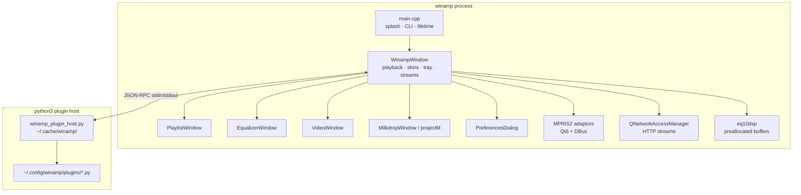

# Contributing to Winamp for Linux

Thank you for helping improve a native classic Winamp experience on Linux. This guide is the developer handbook: environment setup, build matrix, tests, packaging, architecture, and coding standards.

---

## Table of contents

1. [Code of collaboration](#1-code-of-collaboration)
2. [Development environment](#2-development-environment)
3. [Build matrix](#3-build-matrix)
4. [Tests](#4-tests)
5. [Packaging & release](#5-packaging--release)
6. [Architecture](#6-architecture)
7. [Coding standards](#7-coding-standards)
8. [Where to put changes](#8-where-to-put-changes)
9. [Pull request checklist](#9-pull-request-checklist)
10. [Debugging tips](#10-debugging-tips)
11. [Reference moved from the README](#11-reference-moved-from-the-readme)

---

## 1. Code of collaboration

- Prefer **small, reviewable commits** with clear messages (what + why).
- Do **not** commit agent/IDE private instruction stores or vendor-named local harness directories.
- Match existing C++ style; do not reformat unrelated files.
- Do **not** change core playback / gapless logic unless the change is the explicit goal of the PR—audio path regressions are painful.
- Classic UI fidelity beats speculative “modernization” of chrome unless agreed.

---

## 2. Development environment

### Required tools

| Tool | Notes |
|------|--------|
| C++17 compiler | GCC or Clang |
| CMake ≥ 3.16 | Project minimum |
| Ninja | Recommended generator |
| Qt 6 **or** Qt 5 | Qt 6 preferred |
| `libprojectM` | Visualization. CMake uses pkg-config (`libprojectM`) |
| `python3` | Plugin host at runtime (interpreter on `PATH`) |

### Debian / Ubuntu packages

```bash
sudo apt-get update
sudo apt-get install -y \
  build-essential \
  cmake \
  ninja-build \
  file \
  dpkg-dev \
  qt6-base-dev \
  qt6-multimedia-dev \
  libqt6opengl6-dev \
  libqt6multimediawidgets6 \
  libgl-dev \
  libprojectm-dev \
  projectm-data \
  libtag1-dev \
  libavutil-dev \
  pkg-config \
  python3 \
  gstreamer1.0-plugins-good \
  gstreamer1.0-plugins-bad \
  gstreamer1.0-plugins-ugly \
  gstreamer1.0-libav
```

### Optional: Qt 5 toolchain

Install your distribution’s Qt 5 base + multimedia + widgets packages, then configure with `CMAKE_DISABLE_FIND_PACKAGE_Qt6=ON` (see below).

### Clone & first build

```bash
git clone https://github.com/lord3nd3r/winamp-linux.git
cd winamp-linux
cmake -S . -B build-qt6 -G Ninja -DCMAKE_BUILD_TYPE=Debug
ninja -C build-qt6
./build-qt6/winamp
```

Use `Debug` while developing; use `Release` for packaging benchmarks.

---

## 3. Build matrix

### Qt 6 (default)

```bash
cmake -S . -B build-qt6 -G Ninja -DCMAKE_BUILD_TYPE=Debug
ninja -C build-qt6
```

Enables MPRIS2 when Qt DBus is present. The PCM tap (`QAudioBufferOutput`) is compiled only when Qt is 6.8 or newer. That tap is what feeds the spectrum FFT, the EQ10 process, Milkdrop’s samples, and stereo balance. On Qt 6.2 and 6.4 the same source builds, the controls stay on screen, and dragging balance appends ` (NO TAP)`. Audio still plays through `QAudioOutput`.

`libavutil` is optional. When `pkg-config` finds it, configure prints `libavutil found - HAVE_AVUTIL` and `main` calls `av_log_set_level(AV_LOG_ERROR)`. Package names: `libavutil-dev` (Debian/Ubuntu), `libavutil-free-devel` (Fedora), `libavutil-devel` (openSUSE).

### Qt 5 (fallback)

```bash
cmake -S . -B build-qt5 -G Ninja \
  -DCMAKE_DISABLE_FIND_PACKAGE_Qt6=ON \
  -DCMAKE_BUILD_TYPE=Debug
ninja -C build-qt5
```

Expect:

- MPRIS2 disabled
- No PCM tap (Qt 5 has no `QAudioBufferOutput`), so spectrum, EQ processing, Milkdrop samples, and balance stay on the older-Qt path
- Some Qt 6–only multimedia APIs compiled out via `compat.h` / version checks

CI’s `ubuntu-22.04-qt5` job is this configuration: `qtbase5-dev`, `qtmultimedia5-dev`, `libqt5opengl5-dev`, `libqt5multimedia5-plugins`, plus `libavutil-dev`, into `build-qt5`.

### Compiler flags (always on for `winamp` target)

| Flag / define | Purpose |
|---------------|---------|
| `-Wall -Wextra -Wpedantic` | Warning surface |
| `-Wno-unused-parameter` | Qt slot signatures |
| `-fstack-protector-strong` | Stack hardening |
| `_FORTIFY_SOURCE=2` | Fortified libc checks |

**Policy:** zero warnings on both Qt 5 and Qt 6 configurations.

### Useful CMake toggles

| Variable | Effect |
|----------|--------|
| `CMAKE_BUILD_TYPE` | `Debug` / `Release` / `RelWithDebInfo` |
| `CMAKE_DISABLE_FIND_PACKAGE_Qt6=ON` | Force Qt 5 path |
| `CMAKE_INSTALL_PREFIX` | Install root |

---

## 4. Tests

Tests use **Qt Test** and are registered with **CTest**.

```bash
# After configuring build-qt6
ninja -C build-qt6
ctest --test-dir build-qt6 --output-on-failure

# Individual binaries
./build-qt6/winamp_tests
./build-qt6/playlist_tests
./build-qt6/playback_tests
./build-qt6/tag_metadata_tests

# Offscreen (CI / headless SSH)
QT_QPA_PLATFORM=offscreen ctest --test-dir build-qt6 --output-on-failure
```

| Target | Sources | What it asserts |
|--------|---------|-----------------|
| `winamp_tests` / `eq_dsp_test` | `tests/test_eq_dsp.cpp` | dB conversion, setup, gains, process path, balance gain, plugin-host restart limit, Milkdrop channel counts, short sink writes |
| `playlist_tests` / `playlist_test` | `tests/test_playlist.cpp` + playlist/eq/prefs/video objs | Add/clear, navigation, sort, selection, dead file removal, async folder add, M3U/PLS text, duration probes, nested skin archives |
| `playback_tests` / `playback_test` | `tests/test_playback.cpp` | Gapless player swap on every Qt, including the default Qt 6.8+ FFmpeg backend (not skipped), settings write, stale playback callbacks, local playlist enqueue, previous-track wrap, repeat cycle (off → all → one), MPRIS volume and OpenUri |
| `tag_metadata_tests` / `tag_metadata_test` | `tests/test_tag_metadata.cpp` | Tag round trip, ID3v2.3 on write, ID3v1 Latin-1 truncation |

### Adding tests

1. Prefer behavior/contract tests over snapshotting private implementation details.
2. Register with `add_executable` + `add_test` in `CMakeLists.txt`.
3. Keep tests free of network dependency unless mocked.
4. For UI-adjacent code, extract pure logic where possible so Qt Test can host it without full `WinampWindow`.

---

## 5. Packaging & release

### Local CPack

```bash
# Debian / Ubuntu (default: DEB + TGZ)
cmake -S . -B build-qt6 -G Ninja -DCMAKE_BUILD_TYPE=Release \
  -DWINAMP_DISTRO_ID=ubuntu-24.04
ninja -C build-qt6 package
ls -la build-qt6/winamp-*

# Fedora / openSUSE (RPM + TGZ; needs rpm-build)
cmake -S . -B build-rpm -G Ninja -DCMAKE_BUILD_TYPE=Release \
  -DWINAMP_DISTRO_ID=fedora-43 \
  -DCPACK_GENERATOR="RPM;TGZ"
ninja -C build-rpm package
```

| CMake option | Purpose |
|--------------|---------|
| `WINAMP_DISTRO_ID` | Suffix in package filenames (default `linux`) |
| `CPACK_GENERATOR` | `DEB;TGZ` (default) or `RPM;TGZ` |

CPack metadata lives in `CMakeLists.txt` (DEB shlibdeps, RPM autoreq, license, contact).

### GitHub Actions

| Workflow | Path | Trigger | What it does |
|----------|------|---------|--------------|
| **CI** | `.github/workflows/ci.yml` | Push / PR → `master` | Build + `ctest` on a representative distro matrix |
| **Release** | `.github/workflows/release.yml` | Tags `v*`, `workflow_dispatch` | Full package matrix → artifacts; on tags, attach to GitHub Release |

**Release matrix (packages):**

| Distro ID | Image | Package |
|-----------|-------|---------|
| `ubuntu-22.04` | `ubuntu:22.04` | `.deb` + `.tar.gz` |
| `ubuntu-24.04` | `ubuntu:24.04` | `.deb` + `.tar.gz` |
| `ubuntu-resolute` | `ubuntu:resolute` | `.deb` + `.tar.gz` |
| `ubuntu-stonking` | `ubuntu:26.10` | `.deb` + `.tar.gz` (`libprojectm3` 3.1.12, not `libprojectm2v5`) |
| `debian-bookworm` | `debian:bookworm` | `.deb` + `.tar.gz` |
| `debian-trixie` | `debian:trixie` | `.deb` + `.tar.gz` |
| `fedora-43` | `fedora:43` | `.rpm` + `.tar.gz` |
| `fedora-44` | `fedora:44` | `.rpm` + `.tar.gz` |
| `fedora45` | `fedora:45` | `.rpm` + `.tar.gz` (`winamp-<version>-fedora45`) |
| `opensuse-tumbleweed` | `opensuse/tumbleweed` | `.rpm` + `.tar.gz` |
| `arch` | `archlinux:latest` | `.pkg.tar.zst` + `.tar.gz` (`projectm` 3.1.12) |

CI uses a smaller matrix (Ubuntu 22.04/24.04/26.10 stonking, Debian Bookworm, Fedora 43, 44, and 45, openSUSE Tumbleweed) plus a dedicated **`ubuntu-22.04-qt5`** job (`CMAKE_DISABLE_FIND_PACKAGE_Qt6=ON`, build directory `build-qt5`) and an **`arch`** job. Each job installs libavutil and fails the configure step unless the log contains `libavutil found - HAVE_AVUTIL`. The Qt 5 job also requires `Using Qt5`. The Arch job requires `Using Qt6` and `libprojectM` 3.x (`projectm` from Extra, not `libprojectm` 4.x and not AUR `projectm-git`). Ubuntu 26.10 installs `libprojectm-dev`, which depends on `libprojectm3` (= 3.1.12). `dpkg-shlibdeps` records that shared library as `libprojectm3` in the `.deb` Depends line.

### AppImage

`packaging/appimage/build-appimage.sh` produces `Winamp-<version>-x86_64.AppImage`. The release workflow runs it on Ubuntu 22.04 (glibc 2.35, Qt 6.2.4) with `APPIMAGE_SMOKE=1`. A tag named `v1.4.0` sets `VERSION=1.4.0`, so the artifact is `Winamp-1.4.0-x86_64.AppImage` plus a `.zsync` file (`gh-releases-zsync`). linuxdeploy plus the Qt and GStreamer plugins bundle platforms (xcb, Wayland, offscreen), image formats, OpenSSL, GStreamer, TagLib, projectM presets, HarfBuzz, and FriBidi. OpenGL and `python3` stay on the host. Because that Qt is 6.2, the AppImage is a no-tap build: spectrum, EQ processing, Milkdrop samples, and balance are compiled out.

Smoke coverage in the script: `--help`, `--version`, an offscreen launch, and `--cli` against a generated WAV. A `v*` tag attaches the AppImage to the GitHub release; `workflow_dispatch` uploads it as an artifact only.

### Version

`project(Winamp VERSION 1.4.0 ...)` in `CMakeLists.txt` plus `WINAMP_VERSION_FULL` (`1.4.0`) and `kWinampVersion` in `src/constants.h` must stay aligned with **GitHub release tags**. Bump all three when cutting a release, and record the user-visible changes in [CHANGELOG.md](CHANGELOG.md). The AppImage filename uses that same version (`Winamp-1.4.0-x86_64.AppImage`).

---

## 6. Architecture

### Runtime topology



### Component map

| Component | Location | Responsibility |
|-----------|----------|----------------|
| Entry / CLI | `src/main.cpp` | `QApplication`, splash, skin bootstrap, CLI args, owns `PythonPluginManager` |
| Playlist | `src/playlist.{h,cpp}` | Track list, sort, drop, async folder add. Local durations come from TagLib, one file per event-loop tick |
| Main chrome | `src/winamp_window.h` | Player(s), volume/balance, skin painting, song ticker (bitmap font, system font when a glyph is missing), tray, HTTP streams, settings save/load |
| Equalizer UI | `src/equalizer.{h,cpp}` | 10 bands + preamp UI, snap-to-main |
| EQ DSP | `src/eq_dsp.h` | EQ10 processing |
| Plugins | `src/python_plugin.{h,cpp}` | Spawn host, dispatch RPC methods, restart backoff |
| Tags | `src/tag_metadata.cpp` | TagLib read/write; MP3 saves ID3v2.3 |
| Preferences | `src/preferences.{h,cpp}` | Settings UI + plugin manager |
| Video | `src/video.{h,cpp}` | `QVideoWidget` host |
| Visualization | `src/milkdrop.h` | projectM GL window |
| Media library | `src/media_library.h` | Filesystem browser |
| MPRIS2 | `src/mpris2_adaptors.h` | DBus root + player adaptors |
| Modern skins | `src/modern_skin.h` | XML skin parse (depth/cycle guarded) |
| Qt compat | `src/compat.h` | Qt5/Qt6 shims |
| Constants | `src/constants.h` | Layout tables, vis colors, built-in EQ presets |

### Audio path (conceptual)

1. `QMediaPlayer` decodes via the platform multimedia backend.
2. On Qt 6.8+, `QAudioBufferOutput` feeds the spectrum FFT, EQ10, Milkdrop PCM, and balance. Older Qt skips `processAudioBuffer` entirely.
3. EQ uses fixed buffers inside `eq_dsp.h` — **do not allocate on the hot path**.
4. Gapless: secondary player preloads the next playlist item; swap on near-end / end.
5. MP3 File Info writes ID3v2.3 and a truncated ID3v1 tag (`src/tag_metadata.cpp`).
6. `.m3u` / `.pls` parsing lives in `playlistEntries()` (`src/constants.h`). Remote playlists are fetched and every entry is enqueued.

### Plugin path

1. `PythonPluginManager` writes host script to `~/.cache/winamp/winamp_plugin_host.py`.
2. Starts `python3` with that script.
3. Sends `{"type":"event","name":"start"}`; host imports each `*.py` plugin.
4. Plugin API calls become JSON request/notification lines; C++ handles them on the GUI thread and replies when needed.
5. On shutdown: `exit` event, then terminate/kill if needed.
6. If the host exits early, `PluginHostRestart` waits 500 ms, 1 s, 2 s, 4 s, then 8 s, and stops after five crashes (`kMaxRestarts`). A host that stays up for 30 seconds (`kStableResetMs`) resets the count. The host is a separate process with the user’s privileges. It is not a sandbox.

### Window snapping

- Child windows snap within a pixel threshold of the main window edges on X11 and XWayland. A playlist beside the main window keeps its vertical offset.
- Dragging the main window repositions snapped children (`followMain` / `checkSnap`). Native Wayland (`QT_QPA_PLATFORM=wayland`) does not dock them, because `move()` is ignored there.
- Snap state is persisted with window geometry in `winamp.conf`.

---

## 7. Coding standards

| Rule | Detail |
|------|--------|
| **Language** | C++17 |
| **Framework** | Qt 5 *and* Qt 6 must keep compiling |
| **Warnings** | Zero warnings with project flags |
| **Strings / I/O** | Prefer `QString`, `QByteArray`, Qt file APIs over raw C string sinks |
| **Ownership** | Qt parent-child tree (`new Widget(this)`); `WA_DeleteOnClose` for ephemeral dialogs |
| **Headers** | Forward-declare in headers; include in `.cpp` when practical |
| **Audio** | No unbounded locks or heap allocation in DSP process loops |
| **Modern skins** | Do not force-enable modern skins by default (classic is primary) |
| **Plugins** | Keep public API method names stable; document changes in `PLUGIN_DEVELOPMENT.md` |

### Style

- Match surrounding file indentation and naming.
- Avoid drive-by renames that churn blame without behavior change.
- New modules: prefer `.h` + `.cpp` over growing `winamp_window.h` further when feasible.

---

## 8. Where to put changes

| Kind of change | Primary files |
|----------------|---------------|
| Main window chrome / playback orchestration | `winamp_window.h` |
| Playlist behavior | `playlist.{h,cpp}` |
| EQ UI | `equalizer.{h,cpp}` |
| EQ math | `eq_dsp.h` + `tests/test_eq_dsp.cpp` |
| Plugin host / API surface | `python_plugin.{h,cpp}` + plugin docs |
| Preferences pages | `preferences.{h,cpp}` |
| Network stream policy | `playHttpStream` in `winamp_window.h` |
| Skin constants / vis colors | `constants.h`, `winamp_bitmaps.h` |
| Build / deps / install | `CMakeLists.txt` |
| User docs | `README.md`, `CONFIGURATION.md`, `PLUGIN_DEVELOPMENT.md` |

---

## 9. Pull request checklist

- [ ] Builds on **Qt 6** (`build-qt6`)
- [ ] Builds on **Qt 5** if you touched `compat.h`, multimedia ifdefs, or shared headers
- [ ] `ctest --test-dir build-qt6 --output-on-failure` passes
- [ ] No new compiler warnings
- [ ] No secrets, absolute personal paths, or private agent files
- [ ] Docs updated when user-visible behavior or API changes
- [ ] Audio/gapless changes include a short test plan in the PR description

---

## 10. Debugging tips

```bash
# Verbose Qt logging
QT_LOGGING_RULES="*.debug=true" ./build-qt6/winamp

# Plugin host diagnostics (stderr from host + plugins)
./build-qt6/winamp 2>&1 | grep -E 'Python|Plugin'

# Reset user config (destructive to your local settings)
mv ~/.config/winamp ~/.config/winamp.bak.$(date +%s)
```

| Symptom | Things to check |
|---------|-----------------|
| No sound / short formats fail | GStreamer plugin packages; try another file type |
| Plugins not loading | `python3` on `PATH`; files under `~/.config/winamp/plugins/*.py`; look for `[Plugin Host]` lines |
| MPRIS / media keys dead | Qt 6 build? `Qt6DBus` found at configure time? |
| Visualization blank | `libprojectM` + `projectm-data` installed |
| Skin looks wrong | Classic vs modern path; bitmap load paths in `WinampBitmaps::loadAll` |

---

## 11. Reference moved from the README

The front page stays short. The notes below used to live in `README.md`.

### AppImage

The v1.4.0 release attaches `Winamp-1.4.0-x86_64.AppImage` and `Winamp-1.4.0-x86_64.AppImage.zsync`. The release workflow builds it on Ubuntu 22.04 (glibc 2.35) with `packaging/appimage/build-appimage.sh`: linuxdeploy, the Qt plugin, and the GStreamer plugin. The file bundles that image’s Qt 6.2 (xcb, Wayland, and offscreen platform plugins), image formats, the OpenSSL TLS plugin, GStreamer (including libav, plus HarfBuzz and FriBidi so the decoder loads), TagLib, projectM presets, and a desktop file plus icon and AppStream metadata (`io.github.lord3nd3r.winamp`).

Ubuntu 22.04’s Qt is 6.2, which is older than 6.8, so this build has no PCM tap: audio plays, and spectrum, EQ processing, Milkdrop samples, and balance stay inactive (` (NO TAP)` on the balance readout). OpenGL stays on the host (`libOpenGL.so.0`, packages such as `libopengl0` / `libgl1`). Plugins need a host `python3`; the interpreter is not inside the AppImage.

```bash
chmod +x Winamp-1.4.0-x86_64.AppImage
./Winamp-1.4.0-x86_64.AppImage
./Winamp-1.4.0-x86_64.AppImage --version
```

If FUSE is missing, `APPIMAGE_EXTRACT_AND_RUN=1 ./Winamp-1.4.0-x86_64.AppImage`.

### Runtime packages

Decoding is provided by the Qt Multimedia backend. On Debian and Ubuntu that is usually GStreamer:

```bash
sudo apt-get install -y \
  gstreamer1.0-plugins-good \
  gstreamer1.0-plugins-bad \
  gstreamer1.0-plugins-ugly \
  gstreamer1.0-libav
```

A distro package also needs the system copies of the libraries it links. The AppImage already carries Qt, TagLib, projectM, and GStreamer.

```bash
sudo apt-get install -y libprojectm3 libqt6multimediawidgets6 libqt6openglwidgets6 libtag2
```

Ubuntu 26.10 (stonking) ships `libprojectm3` 3.1.12 (`libprojectm-dev`). That `.deb` depends on `libprojectm3`, not the older `libprojectm2v5`. Fedora 45’s RPM is built on `fedora:45` and links FFmpeg 9 `libavutil.so.61`. The Fedora 44 RPM still needs `libavutil.so.60`.

| Package | Role |
|---------|------|
| `qt6-base-dev`, `libqt6opengl6-dev`, multimedia | UI + OpenGL + playback. Qt 6.8+ enables the PCM tap (spectrum, EQ, Milkdrop, balance) |
| `libprojectm-dev`, `projectm-data` | Milkdrop-compatible visualizations |
| `libtag1-dev` | ID3v1/v2 + multi-format tag read and write (File Info / Alt+3). MP3 writes ID3v2.3 |
| `libavutil-dev` | Optional. When `pkg-config` finds it, CMake defines `HAVE_AVUTIL` and the player sets FFmpeg’s log level to error. Fedora’s package is `libavutil-free-devel`; openSUSE’s is `libavutil-devel` |
| `python3` | Out-of-process plugin host (not linked into the binary) |
| `file`, `dpkg-dev` | CPack `.deb` packaging helpers |

Qt 5 fallback packages on Debian/Ubuntu: `qtbase5-dev`, `qtmultimedia5-dev`, `libqt5opengl5-dev`, `libqt5multimedia5-plugins`. Configure with `-DCMAKE_DISABLE_FIND_PACKAGE_Qt6=ON`. Qt 5 builds disable MPRIS2. Qt 5 also has no `QAudioBufferOutput`, so spectrum, EQ processing, Milkdrop samples, and balance follow the older-Qt path.

### Install layout

```bash
cmake --install build-qt6 --prefix /usr/local
```

| Path | Content |
|------|---------|
| `bin/winamp` | Executable |
| `share/applications/winamp.desktop` | Desktop entry |
| `share/icons/hicolor/*/apps/winamp.png` | Themed app icon (16-256px) |
| `share/winamp/skins/` | Skins |
| `share/winamp/resource/` | Classic resource bitmaps |
| `share/winamp/lang/` | Language packs |
| `share/metainfo/io.github.lord3nd3r.winamp.metainfo.xml` | AppStream metadata |

### Containerized package build

```bash
docker run --rm -it -v "$(pwd)":/workspace -w /workspace ubuntu:24.04 bash
# inside:
apt-get update && apt-get install -y \
  cmake ninja-build build-essential \
  qt6-base-dev qt6-multimedia-dev \
  libprojectm-dev projectm-data libtag1-dev libavutil-dev python3 \
  libgstreamer1.0-dev libgstreamer-plugins-base1.0-dev \
  libgl1-mesa-dev file dpkg-dev git
cmake -S . -B build -G Ninja -DCMAKE_BUILD_TYPE=Release \
  -DWINAMP_DISTRO_ID=ubuntu-24.04
ninja -C build package
```

### Arch

Playback, the spectrum and EQ (the PCM tap), and Milkdrop were tested on real Arch hardware with Qt 6 and projectM 3.1.12.

Extra has two different libraries. Install **`projectm` 3.1.12** (`libprojectM` 3.x). Do not use **`libprojectm` 4.1.8**, and do not use the AUR package `projectm-git` (that tree is projectM 4). There is no separate AUR package that still builds 3.1.12; `projectm` in Extra is the 3.x package.

```bash
sudo pacman -S --needed base-devel cmake ninja \
  qt6-base qt6-multimedia qt6-svg qt6-tools \
  taglib ffmpeg python pkgconf projectm
cmake -S . -B build -G Ninja -DCMAKE_BUILD_TYPE=Release
ninja -C build
```

Or install the release package: `sudo pacman -U winamp-1.4.0-arch.pkg.tar.zst`. The PKGBUILD is `packaging/arch/PKGBUILD` and lists `projectm` in `depends`.

### Command line

```text
winamp [options] [files-or-directories...]
```

| Argument | Behavior |
|----------|----------|
| `-h` / `--help` | Print usage and exit |
| `--version` | Print `Winamp 1.4.0` and exit |
| *file* | Add to playlist; plays the first file unless `-enqueue` |
| *directory* | Scan/add folder asynchronously |
| `-enqueue` / `--enqueue` | Add only; do not auto-start playback |
| `-play` / `--play` | Prefer play after enqueue (default for files) |
| `-pause` / `--pause` | Pause if currently playing |
| `-stop` / `--stop` | Stop playback |
| `--tui` / `--cli` | Run in the terminal instead of the GUI |

```bash
./build-qt6/winamp ~/Music/album/*.flac
./build-qt6/winamp -enqueue ~/Music/incoming/
./build-qt6/winamp "https://example.com/stream.mp3"
```

### Terminal mode (`--tui`)

A terminal front-end renders a classic-styled UI in the console: seven-segment time, a color spectrum, kbps/kHz/stereo, and transport/volume/seek bars. It drives the same playback engine as the GUI (gapless, streaming, EQ). No X/Wayland display is required.

```bash
winamp --tui ~/Music/album/*.flac
winamp --cli ~/Music/
winamp --tui "https://example.com/stream.mp3"
```

| Key | Action | Key | Action |
|-----|--------|-----|--------|
| `z` | previous track | `space` | play / pause toggle |
| `x` | play / resume | `c` | pause toggle |
| `v` | stop | `b` | next track |
| `←` / `→` | seek −5s / +5s | `+` / `−` | volume down / up |
| `↑` / `↓` | volume up / down | `q` (or `Ctrl-C`) | quit |

Mouse (xterm mouse tracking): click the transport glyphs, drag the position bar to seek, drag the volume bar or use the scroll wheel. Backend diagnostics go to `~/.cache/winamp/winamp-tui.log`.

### Paths

| Path | Purpose |
|------|---------|
| `~/.config/winamp/winamp.conf` | Main INI settings (geometry, playback, EQ, playlist) |
| `~/.config/winamp/plugins/` | User Python plugins (`*.py`) |
| `~/.config/winamp/bookmarks.txt` | Bookmarks |
| `~/.cache/winamp/` | Plugin host script, extracted skins, `--tui` log |
| `/usr/share/winamp/` | System skins, resources, languages when installed |

Plugins run in a separate `python3` process (JSON-RPC on stdin/stdout). That is process isolation, not an OS sandbox. Full API: [PLUGIN_DEVELOPMENT.md](PLUGIN_DEVELOPMENT.md). Settings keys: [CONFIGURATION.md](CONFIGURATION.md).

### Repository layout

```text
winamp-linux/
├── src/                  # main, window, playlist, EQ, tags, plugins, MPRIS
├── tests/                # Qt Test suites
├── plugins/examples/     # Example Python plugins
├── skins/default/        # Default classic skin
├── assets/               # Classic resource bitmaps
├── icons/hicolor/        # Themed app icon
├── lang/                 # Translation packs
├── docs/images/          # Banner and illustrations
├── packaging/appimage/   # AppImage script (Ubuntu 22.04)
├── packaging/arch/       # PKGBUILD (depends on projectm 3.1.12)
├── packaging/linux/      # AppStream metainfo
└── CMakeLists.txt
```

### Hardening

- Compiler flags: `-Wall -Wextra -Wpedantic`, `-fstack-protector-strong`, `_FORTIFY_SOURCE=2` (skipped when the toolchain already defines `_FORTIFY_SOURCE`, as Arch `makepkg` does).
- HTTP streams: redirect policy, max 5 redirects, 15s transfer timeout.
- Modern skin XML: include recursion depth limit and circular-include detection.
- Python plugins are not sandboxed (no seccomp, filesystem jail, or network policy).

### Known limits

- Classic skins are the primary path. Modern/XML skins are limited.
- Spectrum, EQ processing, Milkdrop samples, and balance need Qt 6.8 `QAudioBufferOutput`. Qt 5 and Qt 6 before 6.8 (Ubuntu 22.04’s 6.2, Ubuntu 24.04’s 6.4, Debian Bookworm, and the AppImage) compile that path out. Playback continues through `QAudioOutput`. Fedora 43, Fedora 44, Fedora 45, openSUSE Tumbleweed, Ubuntu 26.10, and Arch in CI are new enough to build the tap.
- On Qt 6.8+, changing tracks or quitting while a file is still opening waits until that open finishes or fails before the player is destroyed.
- MPRIS2 is Qt 6 + DBus only.
- Plugin restart backoff is 500 ms, 1 s, 2 s, 4 s, 8 s, then stop (five tries). Thirty seconds up resets the count.

---

## License of contributions

By contributing, you agree that your contributions are licensed under the same **GPL-2.0** terms as the project (`LICENSE.md`).
