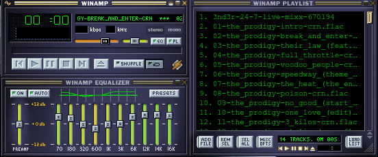

# Winamp for Linux

[](https://3nd3r.net/paypal) [](https://3nd3r.net/cashapp) [](https://3nd3r.net/venmo) [](https://3nd3r.net/btc)

**A native classic Winamp 2.x–style media player for modern Linux desktops.**

**Current release: [v1.3.1](https://github.com/lord3nd3r/winamp-linux/releases/tag/v1.3.1).** Changes by version are in [CHANGELOG.md](CHANGELOG.md).

Built in **C++17** with **Qt 6** (Qt 5 fallback), faithful classic skins, a real 10-band EQ, gapless dual-player audio, out-of-process Python plugins, and desktop integration via MPRIS2.

<p align="center">
  
</p>

<p align="center">
  
  
  
  
  
</p>

<p align="center">
  <a href="#quick-start">Quick start</a> ·
  <a href="#features">Features</a> ·
  <a href="#documentation">Docs</a> ·
  <a href="#command-line">CLI</a> ·
  <a href="#repository-layout">Layout</a> ·
  <a href="#license">License</a>
</p>

---

## Why this project?

Classic Winamp defined how a generation listened to music on the desktop: skinnable chrome, a green spectrum, an always-there playlist editor, and an EQ that actually changed the sound. **Winamp for Linux** brings that workflow to native Linux without a Windows compatibility layer—same interaction model, modern backends (GStreamer / FFmpeg via Qt Multimedia), and extensibility through process-isolated Python plugins.

---

## Features

### Playback & audio
| Feature | Details |
|---------|---------|
| **Local media** | Plays common audio/video formats supported by the Qt Multimedia backend (typically GStreamer or FFmpeg on Linux). |
| **ID3 tags (Winamp 2.x)** | Read/write via TagLib: File Info (Alt+3), playlist “Artist - Title”, sort by title. MP3 saves **ID3v2.3** and an ID3v1 tag. v1 is Latin-1, truncated to 30 bytes (title, artist, album) or 28 (comment). A year outside 1–9999 is left unset. A track outside 1–255 is stored as 0 on v1. |
| **Gapless dual-player** | Next track is preloaded on a second `QMediaPlayer` and swapped at end-of-track to reduce silence between songs. |
| **URL / radio streams** | HTTP(S) and related schemes via `QNetworkAccessManager`, with redirect limits and request timeouts. |
| **Playlists** | `.m3u`, `.m3u8`, and `.pls`. Every M3U line and every PLS `FileN=` entry is enqueued. Relative paths resolve against the playlist. A remote playlist is fetched and every entry is added (nested playlists, up to 3 hops). Only an explicit `http`, `https`, `icy`, or `ftp` scheme counts as remote. |
| **Volume & balance** | Classic 0–255 volume, persisted. Stereo balance is applied on the Qt 6.8 PCM tap. On older Qt the slider still moves and the readout gains ` (NO TAP)`; the pan is left at center in the audio. |
| **Shuffle / repeat** | Playlist shuffle. The classic repeat button, the `R` key, and the modern repeat control share one cycle: off → repeat all → repeat one → off. |
| **Stop after current** | Optional stop when the playing track ends. |

### Classic UI & skins
| Feature | Details |
|---------|---------|
| **Classic skin engine** | Loads classic Winamp bitmaps from a folder or from `.wsz` / `.zip` / `.wal` packs. Archives are read in-process with zlib (no `unzip` program). Nested folders are kept. `~/.cache/winamp/skins/` is rebuilt when the archive’s size, mtime, or SHA-256 changes. |
| **Default skin** | Ships with classic assets under `assets/` and `skins/default/`. |
| **Window snapping** | Main, equalizer, and playlist windows snap and follow each other like the original on X11 and XWayland. Native Wayland does not dock them (the compositor ignores client `move()`). A playlist beside the main window keeps its own height. |
| **Double size & shade** | Double-size mode and shade (title-bar compact) modes. |
| **Always on top** | Optional stay-on-top for the main window. |
| **System tray** | Tray icon, minimize-to-tray options, and song-change notifications. |
| **Spectrum analyzer** | Logarithmic spectrum matching classic Winamp band mapping (`sa_tab[]`-style distribution). Live bars need the Qt 6.8 PCM tap; older Qt draws the chrome with no samples. |

### Equalizer
| Feature | Details |
|---------|---------|
| **10-band graphic EQ** | Bands aligned with classic Winamp (≈60 Hz … 16 kHz). |
| **EQ10 DSP** | Port of **George Yohng’s EQ10** algorithm with preamp and asymmetric Q. The process runs on the Qt 6.8 PCM tap. Older Qt still shows the equalizer window; it does not change the sound. Slider center (32) is 0 dB. |
| **Presets** | Built-in and user-facing preset workflow from the equalizer UI. |
| **Glitch-conscious path** | Pre-allocated DSP buffers on the real-time path (no heap churn in the audio process loop). |

### Extensibility & desktop
| Feature | Details |
|---------|---------|
| **Python plugins** | Out-of-process `python3` host, JSON-RPC over stdin/stdout. A bad plugin cannot crash the player process. This is process isolation, not an OS sandbox: the plugin has the user's normal privileges. A crashed host is restarted after 500 ms, 1 s, 2 s, 4 s, then 8 s, and left stopped after five crashes. A host that stays up for 30 seconds resets that count. |
| **Plugin manager UI** | Preferences → Plug-ins: enable/disable, add, remove, open config. |
| **Example plugins** | `hello_winamp.py`, production-oriented `icecast_dj.py` (Icecast via `ffmpeg`). |
| **MPRIS2** | Media keys and desktop controllers (**Qt 6 + Qt DBus**; off on Qt 5). `Volume` 0–1 maps onto the player’s 0–255 scale. `OpenUri` accepts a local file or `http`/`https`. `Previous` uses the same shuffle and repeat wrap as `Next`. Each track gets its own `mpris:trackid`. |
| **Milkdrop / projectM** | Visualization via `libprojectM` when available. PCM comes from the Qt 6.8 tap; older Qt opens the window without live samples. Presets are loaded from `../share/projectM/presets` next to the binary, then `/usr/local` and `/usr`. |
| **Video window** | Video surface for video tracks. |
| **Media library browser** | Filesystem-oriented media browser window. |
| **Localization** | Language packs under `lang/` (e.g. German, Spanish). |
| **Bookmarks & recent files** | Bookmarked paths/URLs and recent-file history. |

---

## Documentation

| Guide | What it covers |
|-------|----------------|
| **[CHANGELOG.md](CHANGELOG.md)** | Release history (Keep a Changelog), newest first |
| **[CONTRIBUTING.md](CONTRIBUTING.md)** | Dependencies, Qt 5/6 builds, tests, packaging, architecture, coding standards, PR workflow |
| **[CONFIGURATION.md](CONFIGURATION.md)** | Paths, `winamp.conf` keys (verified against source), skins, plugins dir, bookmarks |
| **[PLUGIN_DEVELOPMENT.md](PLUGIN_DEVELOPMENT.md)** | Process isolation (not an OS sandbox), lifecycle hooks, full API reference, examples, Icecast DJ notes |
| **[winamp.png](winamp.png)** | README hero screenshot (classic main + equalizer) |

---

## Quick start

### AppImage

The v1.3.1 release attaches `Winamp-1.3.1-x86_64.AppImage` and `Winamp-1.3.1-x86_64.AppImage.zsync`. The release workflow builds it on Ubuntu 22.04 (glibc 2.35) with `packaging/appimage/build-appimage.sh`: linuxdeploy, the Qt plugin, and the GStreamer plugin. The file bundles that image’s Qt 6.2 (xcb, Wayland, and offscreen platform plugins), image formats, the OpenSSL TLS plugin, GStreamer (including libav, plus HarfBuzz and FriBidi so the decoder loads), TagLib, projectM presets, and a desktop file plus icon and AppStream metadata (`io.github.lord3nd3r.winamp`).

Ubuntu 22.04’s Qt is 6.2, which is older than 6.8, so this build has no PCM tap: audio plays, and spectrum, EQ processing, Milkdrop samples, and balance stay inactive (` (NO TAP)` on the balance readout). OpenGL stays on the host (`libOpenGL.so.0`, packages such as `libopengl0` / `libgl1`). Plugins need a host `python3`; the interpreter is not inside the AppImage.

```bash
chmod +x Winamp-1.3.1-x86_64.AppImage
./Winamp-1.3.1-x86_64.AppImage
./Winamp-1.3.1-x86_64.AppImage --version
```

If FUSE is missing, `APPIMAGE_EXTRACT_AND_RUN=1 ./Winamp-1.3.1-x86_64.AppImage`.

### Runtime dependencies (playback)

Decoding is provided by the Qt Multimedia backend. On Debian and Ubuntu that is usually GStreamer:

```bash
sudo apt-get install -y \
  gstreamer1.0-plugins-good \
  gstreamer1.0-plugins-bad \
  gstreamer1.0-plugins-ugly \
  gstreamer1.0-libav
```

A distro package also needs the system copies of the libraries it links. The AppImage already carries Qt, TagLib, projectM, and GStreamer.

```bash
sudo apt-get install -y libprojectm3 libqt6multimediawidgets6 libqt6openglwidgets6 libtag2
```

### Build dependencies (Debian / Ubuntu)

```bash
sudo apt-get update
sudo apt-get install -y \
  build-essential \
  cmake \
  ninja-build \
  qt6-base-dev \
  qt6-multimedia-dev \
  libqt6opengl6-dev \
  libqt6multimediawidgets6 \
  libgl-dev \
  libprojectm-dev \
  projectm-data \
  libtag1-dev \
  libavutil-dev \
  pkg-config \
  python3 \
  file \
  dpkg-dev
```

| Package | Role |
|---------|------|
| `qt6-base-dev`, `libqt6opengl6-dev`, multimedia | UI + OpenGL + playback. Qt 6.8+ enables the PCM tap (spectrum, EQ, Milkdrop, balance) |
| `libprojectm-dev`, `projectm-data` | Milkdrop-compatible visualizations |
| `libtag1-dev` | ID3v1/v2 + multi-format tag **read and write** (File Info / Alt+3). MP3 writes ID3v2.3 |
| `libavutil-dev` | Optional. When `pkg-config` finds it, CMake defines `HAVE_AVUTIL` and the player sets FFmpeg’s log level to error. Fedora’s package is `libavutil-free-devel`; openSUSE’s is `libavutil-devel` |
| `python3` | Out-of-process plugin host (not linked into the binary) |
| `file`, `dpkg-dev` | CPack `.deb` packaging helpers |

Qt 5 fallback packages on Debian/Ubuntu: `qtbase5-dev`, `qtmultimedia5-dev`, `libqt5opengl5-dev`, `libqt5multimedia5-plugins`. Configure with `-DCMAKE_DISABLE_FIND_PACKAGE_Qt6=ON`.

### Build (Qt 6 — preferred)

```bash
cmake -S . -B build-qt6 -G Ninja -DCMAKE_BUILD_TYPE=Release
ninja -C build-qt6
./build-qt6/winamp
```

### Build (Qt 5 — fallback)

```bash
cmake -S . -B build-qt5 -G Ninja \
  -DCMAKE_DISABLE_FIND_PACKAGE_Qt6=ON \
  -DCMAKE_BUILD_TYPE=Release
ninja -C build-qt5
./build-qt5/winamp
```

Qt 5 builds disable MPRIS2 (the DBus media player interface is compiled for Qt 6). Qt 5 also has no `QAudioBufferOutput`, so spectrum, EQ processing, Milkdrop samples, and balance follow the older-Qt path described above.

### Tests

```bash
ctest --test-dir build-qt6 --output-on-failure
# Headless / CI:
QT_QPA_PLATFORM=offscreen ctest --test-dir build-qt6 --output-on-failure
```

| Test target | Coverage |
|-------------|----------|
| `eq_dsp_test` | EQ helpers, balance gain, plugin-host restart limit, Milkdrop sample counts, short sink writes (`tests/test_eq_dsp.cpp`) |
| `playlist_test` | Playlist ops, selection, async folder add, M3U/PLS text, duration probes, skin archives (`tests/test_playlist.cpp`) |
| `playback_test` | Gapless swap on every Qt, including the Qt 6.8+ FFmpeg backend (that case is not skipped), saved settings, stale playback callbacks, local playlist enqueue, previous-track wrap, repeat cycle, MPRIS volume and OpenUri (`tests/test_playback.cpp`) |
| `tag_metadata_test` | Tag round trip, ID3v2.3 write, ID3v1 truncation (`tests/test_tag_metadata.cpp`) |

### Install / package

```bash
# Install into a prefix (example)
cmake --install build-qt6 --prefix /usr/local

# Or build distribution packages (DEB + TGZ by default)
ninja -C build-qt6 package
# → build-qt6/winamp-*.deb and .tar.gz

# RPM (Fedora / openSUSE) — needs rpm-build installed
cmake -S . -B build-rpm -G Ninja -DCMAKE_BUILD_TYPE=Release \
  -DWINAMP_DISTRO_ID=fedora-43 -DCPACK_GENERATOR="RPM;TGZ"
ninja -C build-rpm package
```

Default install layout (CMake `install` rules):

| Path | Content |
|------|---------|
| `bin/winamp` | Executable |
| `share/applications/winamp.desktop` | Desktop entry |
| `share/icons/hicolor/*/apps/winamp.png` | Themed app icon (16-256px) |
| `share/winamp/skins/` | Skins |
| `share/winamp/resource/` | Classic resource bitmaps |
| `share/winamp/lang/` | Language packs |
| `share/metainfo/io.github.lord3nd3r.winamp.metainfo.xml` | AppStream metadata |

### GitHub multi-distro builds

| Workflow | When | Distros |
|----------|------|---------|
| **CI** (`.github/workflows/ci.yml`) | Push / PR to `master` | Ubuntu 22.04 & 24.04, Debian Bookworm, Fedora 43 & 44, openSUSE Tumbleweed — Qt 6 build + test. A separate `ubuntu-22.04-qt5` job configures with `-DCMAKE_DISABLE_FIND_PACKAGE_Qt6=ON`. Every job installs libavutil (`libavutil-dev`, Fedora `libavutil-free-devel`, openSUSE `libavutil-devel`) and requires the `libavutil found - HAVE_AVUTIL` configure line |
| **Release** (`.github/workflows/release.yml`) | Tags `v*` or manual dispatch | Ubuntu 22.04 / 24.04 / Resolute, Debian Bookworm / Trixie, Fedora 43 / 44, openSUSE Tumbleweed — packages. The `appimage` job (Ubuntu 22.04) builds `Winamp-<version>-x86_64.AppImage` and its `.zsync`. A `v*` tag publishes both with the distro packages |

Release assets are named per distro, for example:

- `winamp-1.3.1-ubuntu-24.04.deb`
- `winamp-1.3.1-fedora-43.rpm`
- matching `.tar.gz` for each matrix entry
- `Winamp-1.3.1-x86_64.AppImage` and `Winamp-1.3.1-x86_64.AppImage.zsync` (Ubuntu 22.04 / Qt 6.2; see [AppImage](#appimage))

**Not packaged in CI:** Arch Linux (repo only ships **projectM 4.x**; this tree still uses the classic 3.x `libprojectM` C++ API). Build from source on Arch once a compatible `libprojectM` is available, or vendor the 3.x library.

### Containerized package build

```bash
docker run --rm -it -v "$(pwd)":/workspace -w /workspace ubuntu:24.04 bash
# inside:
apt-get update && apt-get install -y \
  cmake ninja-build build-essential \
  qt6-base-dev qt6-multimedia-dev \
  libprojectm-dev projectm-data libtag1-dev libavutil-dev python3 \
  libgstreamer1.0-dev libgstreamer-plugins-base1.0-dev \
  libgl1-mesa-dev file dpkg-dev git
cmake -S . -B build -G Ninja -DCMAKE_BUILD_TYPE=Release \
  -DWINAMP_DISTRO_ID=ubuntu-24.04
ninja -C build package
```

---

## Command line

```text
winamp [options] [files-or-directories...]
```

| Argument | Behavior |
|----------|----------|
| `-h` / `--help` | Print usage and exit |
| `--version` | Print `Winamp 1.3.1` and exit |
| *file* | Add to playlist; plays the first file unless `-enqueue` |
| *directory* | Scan/add folder asynchronously |
| `-enqueue` / `--enqueue` | Add only; do not auto-start playback |
| `-play` / `--play` | Prefer play after enqueue (default for files) |
| `-pause` / `--pause` | Pause if currently playing |
| `-stop` / `--stop` | Stop playback |
| `--tui` / `--cli` | Run in the terminal instead of the GUI (see below) |

Examples:

```bash
./build-qt6/winamp ~/Music/album/*.flac
./build-qt6/winamp -enqueue ~/Music/incoming/
./build-qt6/winamp "https://example.com/stream.mp3"
```

---

## Terminal mode (`--tui`)

A dependency-free terminal front-end that renders a classic-Winamp-styled UI
in the console — the seven-segment LCD time readout, a color spectrum analyzer,
kbps/kHz/stereo readout, and transport/volume/seek bars. It drives the same
playback engine as the GUI (gapless, streaming, EQ), so anything that plays in
the window plays here. No X/Wayland display is required, so it works over SSH.

```bash
winamp --tui ~/Music/album/*.flac      # play a set of files in the terminal
winamp --cli ~/Music/                   # load a folder
winamp --tui "https://example.com/stream.mp3"
```

**Keyboard**

| Key | Action | Key | Action |
|-----|--------|-----|--------|
| `z` | previous track | `space` | play / pause toggle |
| `x` | play / resume | `c` | pause toggle |
| `v` | stop | `b` | next track |
| `←` / `→` | seek −5s / +5s | `+` / `−` | volume down / up |
| `↑` / `↓` | volume up / down | `q` (or `Ctrl-C`) | quit |

**Mouse** (any terminal with xterm mouse support)

- Click the transport glyphs — `|◄` prev · `▶` play · `ǁ` pause · `■` stop · `►|` next
- Click or **drag the POS bar** to seek through the track
- Click or drag the VOL bar to set volume; the scroll wheel adjusts volume anywhere

Backend/plugin diagnostics are redirected to `~/.cache/winamp/winamp-tui.log`
so they don't disturb the rendered frame. The GUI is unaffected — run `winamp`
with no `--tui`/`--cli` flag for the classic window.

---

## Python plugins (overview)

Plugins live in:

```text
~/.config/winamp/plugins/*.py
```

They run inside a **separate `python3` process**. The player generates a host script under the cache directory and speaks JSON-RPC on stdin/stdout. Prefer `print(..., file=sys.stderr)` so logs never corrupt the control channel.

Minimal plugin:

```python
def on_winamp_start(api):
    import sys
    print(f"volume={api.get_volume()}", file=sys.stderr)

def on_winamp_exit():
    pass
```

Full API, lifecycle rules, and the Icecast DJ example: **[PLUGIN_DEVELOPMENT.md](PLUGIN_DEVELOPMENT.md)**.

---

## Configuration (overview)

| Path | Purpose |
|------|---------|
| `~/.config/winamp/winamp.conf` | Main INI settings (geometry, playback, EQ, playlist) |
| `~/.config/winamp/plugins/` | User Python plugins |
| `~/.config/winamp/bookmarks.txt` | Bookmarks |
| `~/.cache/winamp/` | Generated plugin host script, extracted skins, and the `--tui` log |
| `/usr/share/winamp/` | System skins, resources, languages (when installed) |

Full key reference: **[CONFIGURATION.md](CONFIGURATION.md)**.

---

## Repository layout

```text
winamp-linux/
├── src/
│   ├── main.cpp              # App entry, splash, CLI, plugin manager lifetime
│   ├── winamp_window.h       # Main window, playback, skins, network streams
│   ├── playlist.{h,cpp}      # Playlist editor + async metadata
│   ├── equalizer.{h,cpp}     # EQ UI
│   ├── eq_dsp.h              # EQ10 DSP core
│   ├── python_plugin.{h,cpp} # Out-of-process plugin host
│   ├── tag_metadata.cpp      # TagLib read/write (ID3v2.3 on MP3)
│   ├── preferences.{h,cpp}   # Preferences dialog (incl. plugin manager)
│   ├── video.{h,cpp}         # Video window
│   ├── milkdrop.h            # projectM visualization window
│   ├── media_library.h       # Media library browser
│   ├── mpris2_adaptors.h     # MPRIS2 DBus (Qt6)
│   ├── modern_skin.h         # Modern skin XML (depth-limited includes)
│   ├── dialogs.h             # File info, open URL, search, about, …
│   ├── constants.h           # Layout constants, vis colors, presets
│   ├── compat.h              # Qt5/Qt6 compatibility shims
│   └── …
├── tests/                    # Qt Test suites
├── plugins/examples/         # Example Python plugins
├── skins/default/            # Default classic skin files
├── assets/                   # Classic resource bitmaps / icons
├── icons/hicolor/            # Themed app icon (installed to share/icons)
├── lang/                     # Translation packs
├── docs/images/              # Extra documentation illustrations
├── packaging/appimage/       # AppImage build script (Ubuntu 22.04 / linuxdeploy)
├── packaging/linux/          # AppStream metainfo template
├── winamp.png                # README hero (classic main + equalizer)
├── CMakeLists.txt
└── winamp.desktop
```

Architecture diagram and contribution workflow: **[CONTRIBUTING.md](CONTRIBUTING.md)**.

---

## Security & hardening notes

- Compiler flags: `-Wall -Wextra -Wpedantic`, `-fstack-protector-strong`, `_FORTIFY_SOURCE=2`.
- HTTP streams: redirect policy + max redirects (5) + transfer timeout (15s).
- Modern skin XML: include recursion depth limit and circular-include detection.
- Python plugins: a separate `python3` process so a plugin crash does not take down the player. It is not a sandbox — no seccomp, filesystem jail, or network policy. Plugins have the full OS privileges of that user process. Treat third-party plugins like any untrusted script.

---

## Roadmap-style known limits

These are intentional or inherited constraints, not silent omissions:

- **Classic skins first** — modern Winamp 5 skin support is limited; classic is the primary path.
- **Qt 6.8 PCM tap** — spectrum, EQ processing, Milkdrop samples, and balance need `QAudioBufferOutput`. Qt 5 and Qt 6 before 6.8 (Ubuntu 22.04’s 6.2, Ubuntu 24.04’s 6.4, Debian Bookworm, and the AppImage) compile that path out. Playback continues through `QAudioOutput`. Fedora 43, Fedora 44, and openSUSE Tumbleweed in CI are new enough to build the tap.
- **Qt 6.8+ FFmpeg opens** — replacing a track or quitting while a file is still opening waits until that open finishes or fails, then delivers the completion, before the player is destroyed. The gapless playback test covers this on the FFmpeg backend and is not skipped.
- **MPRIS2 on Qt 6 only** — Qt 5 builds skip the DBus media player interface.
- **Plugin process isolation** — a separate `python3` process, not an OS sandbox (no seccomp, cgroup, or filesystem jail). Restart backoff is 500 ms, 1 s, 2 s, 4 s, 8 s, then stop (five tries). Thirty seconds up resets the count.
- **Tests** — `eq_dsp_test`, `playlist_test`, `playback_test`, and `tag_metadata_test`. Full UI automation is not in-tree.

---

## License

This project is licensed under the **[GNU General Public License v2.0](LICENSE.md)**.

Classic Winamp is a trademark of its respective owners. This project is an independent Linux reimplementation inspired by the classic player; it is not affiliated with or endorsed by the original Winamp vendors.

---

## Credits

- Classic Winamp UX — the original Nullsoft Winamp 2.x design language
- **George Yohng** — EQ10 equalizer algorithm (ported in `eq_dsp.h`)
- **projectM** — Milkdrop-compatible visualization engine
- **Qt Project** — application framework and multimedia stack
- Contributors to this repository and its example plugins
