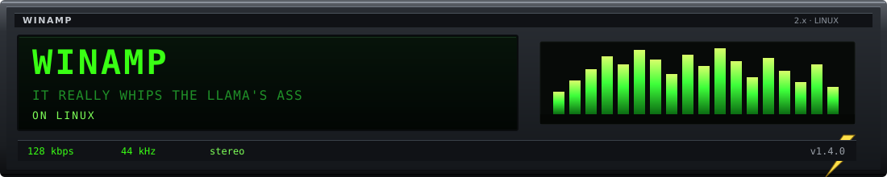
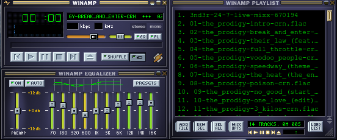
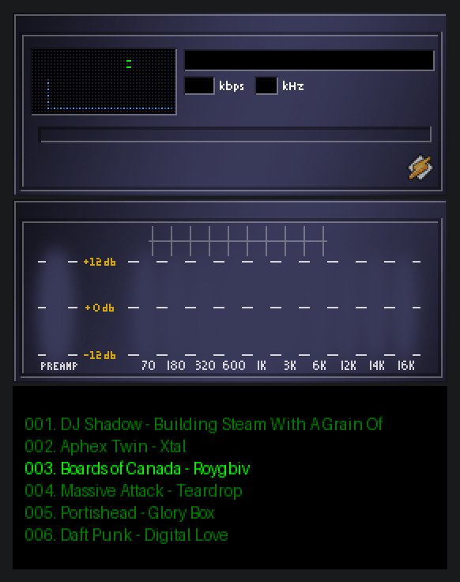

<p align="center">
  
</p>

<p align="center">
  <a href="https://github.com/lord3nd3r/winamp-linux/releases/tag/v1.4.0"></a>
  <a href="https://github.com/lord3nd3r/winamp-linux/actions/workflows/ci.yml"></a>
  <a href="LICENSE.md"></a>
  
</p>

<p align="center"><strong>It really whips the llama's ass... on Linux.</strong></p>

<p align="center">
  A native Winamp 2.x player. Classic skins, green spectrum, 10-band EQ, playlist editor.<br>
  <a href="https://github.com/lord3nd3r/winamp-linux/releases/tag/v1.4.0">v1.4.0</a>
  ·
  <a href="#-download--install">Download</a>
  ·
  <a href="#-keyboard">Keys</a>
  ·
  <a href="CHANGELOG.md">Changelog</a>
</p>

<p align="center">
  
</p>

<p align="center">
  
</p>

## ⚡ Now playing

Drop files, load a `.wsz`, and hit play. Qt 6 (Qt 5 still builds) talks to GStreamer or FFmpeg. The next song is preloaded so the gap stays short. On Qt 6.8+ the spectrum, EQ, Milkdrop, and balance ride a PCM tap. Older Qt, including the AppImage, still plays; those four stay dark and the balance readout says ` (NO TAP)`.

## 🎧 Features

- **Skins.** Classic bitmaps from a folder or `.wsz` / `.zip` / `.wal`. The skin you pick is remembered. A missing file falls back to the built-in default.
- **Playlist.** `.m3u`, `.m3u8`, `.pls`. Footer time is the sum of local lengths from TagLib.
- **Ticker.** Bitmap font for ASCII. A title the bitmap cannot draw (Cyrillic, for example) scrolls in a small system font.
- **EQ.** 10 bands plus preamp (George Yohng’s EQ10) when the PCM tap is on.
- **Shuffle / repeat.** Repeat cycles off → all → one. Previous follows the same wrap as Next.
- **Streams.** HTTP(S) with redirect and timeout limits.
- **MPRIS2.** Media keys on Qt 6 with D-Bus.
- **Plugins.** Python, out of process. Not a sandbox.
- **Desktop.** Tray, video window, bookmarks, recent files, English / German / Spanish packs.
- **Windows.** Snap and dock on X11 and XWayland. Native Wayland does not let the app place them.

## 📻 Download & install

[v1.4.0](https://github.com/lord3nd3r/winamp-linux/releases/tag/v1.4.0). Each distro package uses that system’s Qt. The AppImage is Ubuntu 22.04’s Qt 6.2: one file, no PCM tap.

| Distro | Package | Install |
|--------|---------|---------|
| Ubuntu 22.04 | [deb](https://github.com/lord3nd3r/winamp-linux/releases/download/v1.4.0/winamp-1.4.0-ubuntu-22.04.deb) | `sudo apt install ./winamp-1.4.0-ubuntu-22.04.deb` |
| Ubuntu 24.04 | [deb](https://github.com/lord3nd3r/winamp-linux/releases/download/v1.4.0/winamp-1.4.0-ubuntu-24.04.deb) | `sudo apt install ./winamp-1.4.0-ubuntu-24.04.deb` |
| Ubuntu Resolute | [deb](https://github.com/lord3nd3r/winamp-linux/releases/download/v1.4.0/winamp-1.4.0-ubuntu-resolute.deb) | `sudo apt install ./winamp-1.4.0-ubuntu-resolute.deb` |
| Ubuntu 26.10 | [deb](https://github.com/lord3nd3r/winamp-linux/releases/download/v1.4.0/winamp-1.4.0-ubuntu-stonking.deb) | `sudo apt install ./winamp-1.4.0-ubuntu-stonking.deb` |
| Debian Bookworm | [deb](https://github.com/lord3nd3r/winamp-linux/releases/download/v1.4.0/winamp-1.4.0-debian-bookworm.deb) | `sudo apt install ./winamp-1.4.0-debian-bookworm.deb` |
| Debian Trixie | [deb](https://github.com/lord3nd3r/winamp-linux/releases/download/v1.4.0/winamp-1.4.0-debian-trixie.deb) | `sudo apt install ./winamp-1.4.0-debian-trixie.deb` |
| Fedora 43 | [rpm](https://github.com/lord3nd3r/winamp-linux/releases/download/v1.4.0/winamp-1.4.0-fedora-43.rpm) | `sudo dnf install ./winamp-1.4.0-fedora-43.rpm` |
| Fedora 44 | [rpm](https://github.com/lord3nd3r/winamp-linux/releases/download/v1.4.0/winamp-1.4.0-fedora-44.rpm) | `sudo dnf install ./winamp-1.4.0-fedora-44.rpm` |
| Fedora 45 | [rpm](https://github.com/lord3nd3r/winamp-linux/releases/download/v1.4.0/winamp-1.4.0-fedora45.rpm) | `sudo dnf install ./winamp-1.4.0-fedora45.rpm` |
| openSUSE Tumbleweed | [rpm](https://github.com/lord3nd3r/winamp-linux/releases/download/v1.4.0/winamp-1.4.0-opensuse-tumbleweed.rpm) | `sudo zypper install ./winamp-1.4.0-opensuse-tumbleweed.rpm` |
| Arch Linux | [pkg](https://github.com/lord3nd3r/winamp-linux/releases/download/v1.4.0/winamp-1.4.0-arch.pkg.tar.zst) | `sudo pacman -U winamp-1.4.0-arch.pkg.tar.zst` |
| AppImage | [AppImage](https://github.com/lord3nd3r/winamp-linux/releases/download/v1.4.0/Winamp-1.4.0-x86_64.AppImage) | `chmod +x Winamp-1.4.0-x86_64.AppImage && ./Winamp-1.4.0-x86_64.AppImage` |

Matching `.tar.gz` files (and the AppImage `.zsync`) sit on the same release. No FUSE: `APPIMAGE_EXTRACT_AND_RUN=1 ./Winamp-1.4.0-x86_64.AppImage`.

Arch needs Extra’s **`projectm` 3.1.12**, which the package depends on. Do not swap in `libprojectm` 4.x.

## 🦙 Skins

Preferences saves the archive or folder you chose and loads it next time. Classic `.wsz` packs from [skins.webamp.org](https://skins.webamp.org/) are the usual source. The player reads them in-process (no `unzip` program). If that file is gone, you get the built-in default.

## 📊 Milkdrop

Visualization is projectM (`libprojectM` 3.x). Samples need the Qt 6.8 PCM tap, so the AppImage opens the window without live audio. Presets are loaded from `../share/projectM/presets` next to the binary, then `/usr/local` and `/usr`. On real Arch hardware, playback, the spectrum, the EQ, and Milkdrop all ran with Qt 6 and projectM 3.1.12.

## 🔧 Quick build

```bash
cmake -S . -B build -G Ninja -DCMAKE_BUILD_TYPE=Release
ninja -C build
./build/winamp
```

Qt 6 is preferred. Qt 5: `-DCMAKE_DISABLE_FIND_PACKAGE_Qt6=ON`. Packages, tests, and the distro matrix are in [docs/BUILDING.md](docs/BUILDING.md) and [docs/CI.md](docs/CI.md).

## ⌨ Keyboard

| Key | Action |
|-----|--------|
| `Z` `X` `C` `V` `B` | Previous, play, pause, stop, next |
| `Space` | Play / pause |
| `←` `→` | Seek ±5 s |
| `↑` `↓` `+` `−` | Volume |
| `S` `R` | Shuffle, repeat cycle |
| `L` / `Ctrl+L` | Open file / play location |
| `J` / `Ctrl+J` | Jump to time / jump to file |
| `Ctrl+D` `Ctrl+W` `Ctrl+T` | Double size, shade, always on top |
| `Ctrl+P` `Alt+3` | Preferences, file info |
| Playlist `Enter` `Del` | Play selection, remove |
| `Ctrl+Del` | Crop to selection |
| `Ctrl+Shift+1/2/3` | Sort by title, filename, path |

Terminal UI: `winamp --tui`. Keys for that mode are in [docs/ARCHITECTURE.md](docs/ARCHITECTURE.md#terminal-mode---tui).

## 📚 More

| | |
|--|--|
| [CHANGELOG.md](CHANGELOG.md) | What changed |
| [CONFIGURATION.md](CONFIGURATION.md) | `winamp.conf` and paths |
| [docs/BUILDING.md](docs/BUILDING.md) | Dependencies, Qt 5 / Qt 6, packages, tests |
| [docs/CI.md](docs/CI.md) | CI and the release distro matrix |
| [docs/ARCHITECTURE.md](docs/ARCHITECTURE.md) | Components, CLI, terminal UI, limits |
| [CONTRIBUTING.md](CONTRIBUTING.md) | How to send a change |
| [PLUGIN_DEVELOPMENT.md](PLUGIN_DEVELOPMENT.md) | Python plugin API |

Plugins live in `~/.config/winamp/plugins/*.py`. Settings live in `~/.config/winamp/winamp.conf`.

<p align="center">
  <a href="https://3nd3r.net/paypal"></a>
  <a href="https://3nd3r.net/cashapp"></a>
  <a href="https://3nd3r.net/venmo"></a>
  <a href="https://3nd3r.net/btc"></a>
</p>

## License

[GNU GPL v2.0](LICENSE.md).

Winamp and the llama line are trademarks of their owners. This is an independent Linux player in that style. It is not affiliated with or endorsed by Winamp or Llama Group.

EQ10 is George Yohng’s algorithm. Milkdrop visuals go through projectM. The UI toolkit is Qt.
