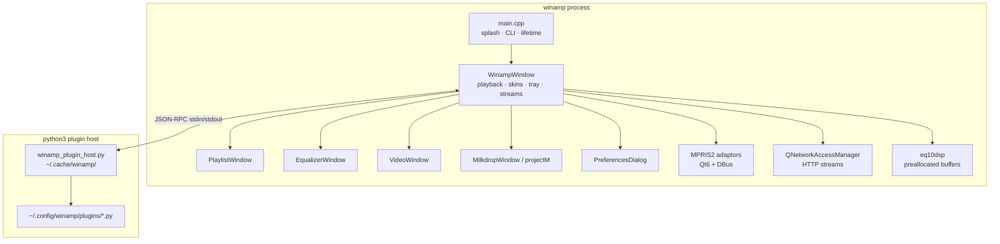

# Architecture

How the player is structured. Build steps are in [BUILDING.md](BUILDING.md). Settings keys are in [CONFIGURATION.md](../CONFIGURATION.md).

## Runtime



| Component | Location | Responsibility |
|-----------|----------|----------------|
| Entry / CLI | `src/main.cpp` | `QApplication`, splash, skin bootstrap, CLI args, owns `PythonPluginManager` |
| Main chrome | `src/winamp_window.h` | Players, volume/balance, skin painting, song ticker (bitmap font, system font when a glyph is missing), tray, HTTP streams, settings |
| Playlist | `src/playlist.{h,cpp}` | Track list, sort, drop, async folder add. Local durations come from TagLib, one file per event-loop tick |
| Equalizer UI | `src/equalizer.{h,cpp}` | 10 bands + preamp UI, snap-to-main |
| EQ DSP | `src/eq_dsp.h` | EQ10 processing |
| Plugins | `src/python_plugin.{h,cpp}` | Spawn host, dispatch RPC, restart backoff |
| Tags | `src/tag_metadata.cpp` | TagLib read/write; MP3 saves ID3v2.3 |
| Preferences | `src/preferences.{h,cpp}` | Settings UI and plugin manager |
| Video | `src/video.{h,cpp}` | `QVideoWidget` host |
| Visualization | `src/milkdrop.h` | projectM GL window |
| Media library | `src/media_library.h` | Filesystem browser |
| MPRIS2 | `src/mpris2_adaptors.h` | D-Bus root and player adaptors |
| Modern skins | `src/modern_skin.h` | XML skin parse (depth and cycle guarded) |
| Qt compat | `src/compat.h` | Qt 5 / Qt 6 shims |
| Constants | `src/constants.h` | Layout tables, vis colors, built-in EQ presets |

## Audio path

1. `QMediaPlayer` decodes through the platform multimedia backend.
2. On Qt 6.8+, `QAudioBufferOutput` feeds the spectrum FFT, EQ10, Milkdrop PCM, and balance. Older Qt skips `processAudioBuffer`.
3. EQ uses fixed buffers in `eq_dsp.h`. Do not allocate on that hot path.
4. Gapless playback preloads the next playlist item on a second player and swaps at end of track.
5. MP3 File Info writes ID3v2.3 and a truncated ID3v1 tag (`src/tag_metadata.cpp`).
6. `.m3u` / `.pls` parsing lives in `playlistEntries()` (`src/constants.h`). A remote playlist is fetched and every entry is enqueued.

## Plugins

1. `PythonPluginManager` writes `~/.cache/winamp/winamp_plugin_host.py`.
2. It starts `python3` with that script.
3. It sends `{"type":"event","name":"start"}`. The host imports each `*.py` plugin.
4. API calls are JSON lines. C++ handles them on the GUI thread and replies when needed.
5. On shutdown it sends `exit`, then terminate or kill if needed.
6. If the host exits early, restart waits 500 ms, 1 s, 2 s, 4 s, then 8 s, and stops after five crashes (`kMaxRestarts`). A host that stays up for 30 seconds (`kStableResetMs`) resets the count. The host is a separate process with the user’s privileges. It is not a sandbox.

The public API is in [PLUGIN_DEVELOPMENT.md](../PLUGIN_DEVELOPMENT.md).

## Window snapping

Child windows snap within a pixel threshold of the main window edges on X11 and XWayland. A playlist beside the main window keeps its vertical offset. Dragging the main window repositions snapped children (`followMain` / `checkSnap`). Native Wayland (`QT_QPA_PLATFORM=wayland`) does not dock them, because `move()` is ignored there. Snap state is stored with window geometry in `winamp.conf`.

## Command line

```text
winamp [options] [files-or-directories...]
```

| Argument | Behavior |
|----------|----------|
| `-h` / `--help` | Print usage and exit |
| `--version` | Print `Winamp 1.4.0` and exit |
| *file* | Add to playlist; plays the first file unless `-enqueue` |
| *directory* | Scan and add the folder asynchronously |
| `-enqueue` / `--enqueue` | Add only; do not auto-start playback |
| `-play` / `--play` | Prefer play after enqueue (default for files) |
| `-pause` / `--pause` | Pause if currently playing |
| `-stop` / `--stop` | Stop playback |
| `--tui` / `--cli` | Terminal UI instead of the window |

```bash
./build-qt6/winamp ~/Music/album/*.flac
./build-qt6/winamp -enqueue ~/Music/incoming/
./build-qt6/winamp "https://example.com/stream.mp3"
```

## Terminal mode (`--tui`)

The terminal front end draws a classic-styled frame: seven-segment time, a color spectrum, kbps/kHz/stereo, and transport, volume, and seek bars. It uses the same playback engine as the window (gapless, streaming, EQ). No X or Wayland display is required.

```bash
winamp --tui ~/Music/album/*.flac
winamp --cli ~/Music/
winamp --tui "https://example.com/stream.mp3"
```

| Key | Action | Key | Action |
|-----|--------|-----|--------|
| `z` | previous track | `space` | play / pause |
| `x` | play / resume | `c` | pause |
| `v` | stop | `b` | next track |
| `←` / `→` | seek −5 s / +5 s | `+` / `−` | volume down / up |
| `↑` / `↓` | volume up / down | `q` or `Ctrl-C` | quit |

With xterm mouse tracking, click the transport glyphs, drag the position bar to seek, or drag the volume bar. The scroll wheel changes volume. Backend diagnostics go to `~/.cache/winamp/winamp-tui.log`.

## Paths

| Path | Purpose |
|------|---------|
| `~/.config/winamp/winamp.conf` | Geometry, playback, EQ, playlist |
| `~/.config/winamp/plugins/` | User Python plugins (`*.py`) |
| `~/.config/winamp/bookmarks.txt` | Bookmarks |
| `~/.cache/winamp/` | Plugin host script, extracted skins, `--tui` log |
| `/usr/share/winamp/` | System skins, resources, and languages when installed |

## Repository layout

```text
winamp-linux/
├── src/                  # main, window, playlist, EQ, tags, plugins, MPRIS
├── tests/                # Qt Test suites
├── plugins/examples/     # Example Python plugins
├── skins/default/        # Default classic skin
├── assets/               # Classic resource bitmaps
├── icons/hicolor/        # Themed app icon
├── lang/                 # Translation packs
├── docs/                 # BUILDING, CI, ARCHITECTURE, images
├── packaging/appimage/   # AppImage script (Ubuntu 22.04)
├── packaging/arch/       # PKGBUILD (depends on projectm 3.1.12)
├── packaging/linux/      # AppStream metainfo
└── CMakeLists.txt
```

## Hardening

- Compiler flags are listed in [BUILDING.md](BUILDING.md#compiler-flags).
- HTTP streams: redirect policy, at most 5 redirects, 15 s transfer timeout.
- Modern skin XML limits include depth and rejects a circular include.
- Python plugins are not sandboxed (no seccomp, filesystem jail, or network policy).

## Known limits

- Classic skins are the primary path. Modern/XML skins are limited.
- Spectrum, EQ processing, Milkdrop samples, and balance need Qt 6.8 `QAudioBufferOutput`. Qt 5 and Qt 6 before 6.8 (Ubuntu 22.04’s 6.2, Ubuntu 24.04’s 6.4, Debian Bookworm, and the AppImage) compile that path out. Playback continues through `QAudioOutput`. Fedora 43, Fedora 44, Fedora 45, openSUSE Tumbleweed, Ubuntu 26.10, and Arch in CI are new enough to build the tap.
- On Qt 6.8+, changing tracks or quitting while a file is still opening waits until that open finishes or fails before the player is destroyed.
- MPRIS2 is Qt 6 with D-Bus only.
- Plugin restart backoff is 500 ms, 1 s, 2 s, 4 s, 8 s, then stop after five tries. Thirty seconds up resets the count.
